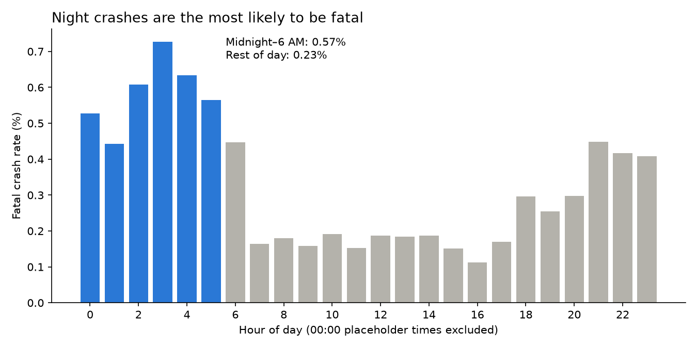

# NYC Collision Risk: When Are Crashes Most Severe?

Frequency and severity analysis of 273,483 NYC motor vehicle crashes (2023–2025), using
methods from insurance risk modelling: frequency vs severity, Poisson fit, and
conditional probabilities.

## Question
When and where are serious collisions most likely in NYC, and what drives severity?

## Data
- NYC Open Data, [Motor Vehicle Collisions – Crashes](https://data.cityofnewyork.us/Public-Safety/Motor-Vehicle-Collisions-Crashes/h9gi-nx95),
  filtered to 2023–2025 (full years, post-COVID)
- One row per crash: date/time, location, people injured/killed by type, contributing factors
- **Severity tiers:** injury crash (≥1 injured or killed, 43%) and fatal crash (≥1 killed, 737 crashes, 0.27%)

## Data cleaning ([01_load_and_clean](notebooks/01_load_and_clean.ipynb))
- **Missing borough (23%)**, mostly on highways (40% vs 5%), so dropping those rows would bias
  location results. Recovered from latitude/longitude with k-NN (99.93% held-out accuracy),
  cutting missing borough to 4.7%.
- **"00:00" crash times** appear ~2× more than any other round hour, likely placeholders,
  so they're excluded from hour-of-day analysis.

## Analysis & findings

**Frequency ([02_frequency_severity](notebooks/02_frequency_severity.ipynb))**
- Crashes fell ~11% from 2023 to 2025 (96,608 → 85,559).
- Crashes peak at 5 PM (~17,000) and are lowest at 3 AM (~4,800), tracking traffic volume.

**Severity: night crashes are fewer but deadlier**
- Night crashes (midnight–6 AM) are less likely to cause injury but more likely to be fatal:
  **0.57% vs 0.23%**, about 2.5× (two-proportion z-test, z = 11.5, p < 0.001).

**Where: borough matters less than time or who's hurt**
- Fatal rates are similar across boroughs (0.23%–0.30%); a chi-square test found no
  significant difference (χ² = 5.88, p = 0.21).
- Staten Island has the lowest injury rate (38% vs ~44% elsewhere).

**Who gets hurt matters ([03_probability](notebooks/03_probability.ipynb))**
- When a pedestrian is hurt, the crash is fatal **1.28%** of the time vs 0.43% otherwise,
  about 3× (z = 15.6, p < 0.001).

**Is the daily fatal count Poisson?**
- Mean (0.672) ≈ variance (0.684), but a chi-square goodness-of-fit test rejects Poisson
  (χ² = 9.69, p = 0.008): more 0- and 2-death days than expected.
- This suggests risk varies day to day, so a single-rate model would underestimate bad days.

## Recommendation
1. Prioritize pedestrian safety measures through crossings, lower speed limits in high-foot-traffic areas: a crash that injures a pedestrian is about 3x more likely to be fatal (1.28% vs 0.43%) 
2. More night-time enforcement (midnight–6 AM) on likely causes such as speeding and impaired driving: night crashes are about 2.5× more likely to be fatal (0.57% vs 0.23%).
3. Risk models shouldn't assume a constant daily rate: a Poisson model underestimated days with 2 fatal crashes (152 observed vs 126.5 predicted). Rates should vary by conditions such as time of day, or use a distribution that allows extra variation (e.g. negative binomial).

## Limitations
- Observational data: shows patterns, not causes.
- Pedestrians and cyclists are only recorded when hurt.
- Tests assume crashes are independent; shared conditions (weather, day) may make p-values optimistic.

## How to run
1. Download the dataset (link above), filter to 2023–2025 and save as data/Motor_Vehicle_Collisions_-_Crashes_20261107.csv.
2. `pip install -r requirements.txt`
3. Run the notebooks in order (01 → 02 → 03).

## Tools
Python (pandas, NumPy, SciPy, scikit-learn, matplotlib), Jupyter